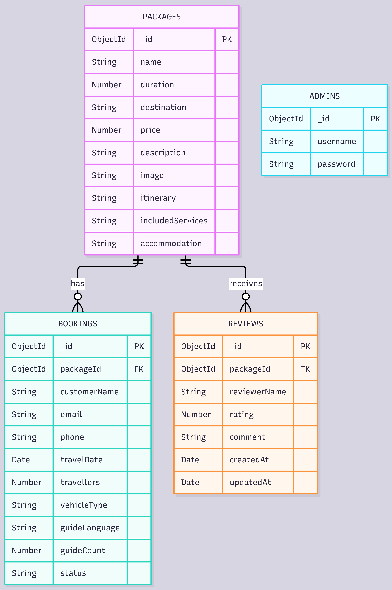

# Explore Sri Lanka – Journey Beyond Limits

## Project Overview

Explore Sri Lanka is a web-based travel booking and management system developed as a university mini-project.

The application allows tourists to explore Sri Lankan destinations, view tour packages, submit booking requests, track booking status, and share reviews.

Administrators can manage tour packages and update customer booking statuses.

## Technologies Used

### Frontend
- React.js
- Vite
- HTML
- CSS
- JavaScript
- React Router

### Backend
- Node.js
- Express.js

### Database
- MongoDB Atlas
- Mongoose

### Authentication
- JSON Web Tokens (JWT)
- bcryptjs

### Version Control
- Git and GitHub

## Main Features

### Tourist Features
- View destinations and tour packages
- Search packages by name or destination
- Filter packages by duration
- Sort packages by price
- View package itineraries and included services
- Submit booking requests
- Track booking status using a reference and email
- Submit and read visitor reviews and ratings

### Administrator Features
- Secure administrator login
- Create, read, update and delete tour packages
- View customer booking requests
- Search, filter and sort bookings
- Confirm or cancel booking requests
- Restrict deletion of packages with related records

## Database Collections

The application uses four collections:

1. packages
2. bookings
3. reviews
4. admins

Each booking references a tour package using packageId.

Each review also references a tour package using packageId.

Administrator accounts are stored separately for authentication.

## Project Structure

Explore-Sri-Lanka/
- frontend/
  - src/
    - components/
    - pages/
  - public/
    - images/
- backend/
  - models/
  - server.js
- README.md

## Installation and Setup

### Requirements

- Node.js and npm
- MongoDB Atlas account
- Git
- Visual Studio Code or another code editor

### 1. Clone the Repository

```bash
git clone https://github.com/lknayana/Explore-Sri-Lanka.git
cd Explore-Sri-Lanka
```

### 2. Install Backend Dependencies

```bash
cd backend
npm install
```

### 3. Configure Environment Variables

Create a `.env` file inside the backend folder.

Add the following variables:

```env
MONGO_URI=your_mongodb_connection_string
JWT_SECRET=your_secret_key
PORT=5000
```

Do not upload the real `.env` file to GitHub.

Configure MongoDB Atlas Network Access to allow your current IP address.

### 4. Start the Backend

```bash
node server.js
```

The backend runs at:

http://localhost:5000

### 5. Install Frontend Dependencies

Open another terminal.

```bash
cd frontend
npm install
npm run dev
```

The frontend runs at:

http://localhost:5173

## Administrator Access

Administrator accounts are stored in MongoDB with hashed passwords.

The application uses JWT authentication to protect administrator operations.

A valid administrator account must already exist in the database.

Administrator login page:

http://localhost:5173/admin/login


## CRUD Operations

The application uses MongoDB Atlas to store data persistently.

### 1. Tour Package Management (Full CRUD)

Tour Packages are the main CRUD entity, managed by the administrator.

**Create**
- Add new tour packages.
- Enter package name, destination, duration, price and description.
- Add images, itineraries, included services and accommodation details.

**Read**
- Display all available packages.
- Search packages by name or destination.
- Filter packages by duration (1, 3 or 5 days).
- Sort packages by price.
- View complete package details.
- Display featured packages on the homepage.

**Update**
- Edit existing package information.
- Update prices, destinations, itineraries, services and accommodation.
- Display updated information on tourist pages.

**Delete**
- Delete existing tour packages.
- Request confirmation before deletion.
- Prevent deletion when related bookings exist.

### 2. Tourist Booking Management

**Create**
- Tourists submit booking requests.
- Provide personal information, travel dates and travel preferences.
- Bookings are saved with Pending status.

**Read**
- Administrators view all booking requests.
- Search bookings by customer or package.
- Filter bookings by status.
- Sort bookings by travel date or customer name.
- Tourists track bookings using their booking reference and email.

**Update**
- Administrators confirm or cancel booking requests.
- Updated booking statuses are stored in MongoDB.
- Tourists can view the updated status through Booking Tracking.

Booking deletion and editing of booking details are not implemented.

### 3. Visitor Reviews and Ratings

**Create**
- Visitors submit reviews for tour packages.
- Each review contains a name, rating and comment.
- Reviews are stored in MongoDB with a reference to the related package.

**Read**
- Display visitor reviews on the Package Details page.
- Show review ratings and comments.
- Calculate and display the average rating.
- Display reviews in newest-first order.


### 4. Administrator Authentication

- Administrator accounts are stored in MongoDB.
- Passwords are hashed using bcryptjs.
- Administrators log in using their credentials.
- JWT authentication protects administrator operations.
- Administrators can log out.

Authentication is a supporting feature, not a separate full CRUD implementation.

### Database Relationships

- One tour package can have multiple bookings.
- One tour package can have multiple reviews.
- Bookings and reviews store the related package ID.
- Administrators are maintained in a separate collection.

All database changes persist after refreshing or restarting the application.


### Database ER Diagram

The following diagram illustrates the main MongoDB collections
and their logical relationships.



Packages are linked to Bookings and Reviews through the
packageId field. Admins are stored independently for authentication.


## Validation and Error Handling

The application includes frontend and backend validation for package information, booking requests and visitor reviews.

Protected administrator APIs require a valid authentication token.

## Academic Project Note

This application was developed for educational demonstration purposes.

Contact details are sample information. Visitor reviews are not verified as completed tour bookings.
